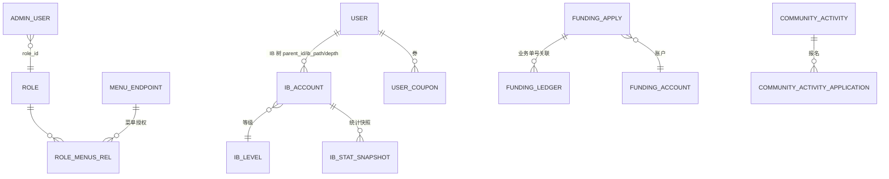

# g-blockmatrix-api 交接文档（MX Blockmatrix 后台管理 API）

> 文档生成日期：2026-10-12 ｜ 依据代码库实际内容整理，密钥已全部脱敏（只记配置项名与位置，不含明文）
> 与 `docs/blockmatrix.md`（2026-04-13 旧版交接文档）互补；旧版中已过时的信息（仓库名、版本号）以本文为准。

---

## 一、项目概览与 GitHub 关联

| 项 | 内容 |
|---|---|
| GitHub 仓库 | **https://github.com/Global-MongoX/g-blockmatrix-api**（⚠️ 组织为 Global-MongoX，非 SwallowedStarX） |
| 仓库曾用名 | `backend-blockmatrix`（旧交接文档/旧引用中可能出现） |
| 本地目录 | `/Users/maluyang/git/mx/blockmatrix`（目录名 `blockmatrix` ≠ 仓库名 `g-blockmatrix-api`） |
| 当前分支 | `main`（生产分支；`develop` 为开发环境分支） |
| 最近提交 | 2026-10-10 Merge PR #142 `feature/user_favorite` |
| 项目定位 | **Blockmatrix 业务的后台管理 API**：统一承载权限（登录/角色/菜单/管理员）、用户与 IB（申请/账户树/等级/佣金规则）、资金（入出金审核/流水/账户）、交易与赛事数据、运营配置（积分/徽章/消息模板/黑白名单/素材）等后台能力，供内部管理前端调用 |
| 技术形态 | PHP 8.5 + Laravel 13 单体 API（前后端分离）；MySQL 多库读写分离 + Redis + Kafka + gRPC；GitHub Actions CI；**无 supervisor 配置入库**（README 说明 legacy `deploy/supervisor` 已移除，由运维侧管理） |
| 工程成熟度 | 有 CI（测试/Larastan/audit）、46 个业务 migration、schema 快照、Scramble 自动 API 文档、开发规范（`CLAUDE.md`）与发布规范（`docs/development/git-release.md`） |

## 二、业务框架与技术栈版本说明

来源：`composer.json` / `composer.lock` / `.github/workflows/ci.yml`

| 组件 | 版本 | 说明 |
|---|---|---|
| PHP | **8.5**（CI 固定） | 扩展要求：`bcmath` `grpc` `rdkafka` `redis` `pdo_sqlite` `zip` |
| laravel/framework | **v13.12.0**（composer.lock） | ⚠️ `composer.json` 的 require 中**没有直接声明** laravel/framework，它经 `shimmer/scaffold` 传递引入——升级框架必须随 scaffold 版本走 |
| shimmer/scaffold | v1.7.2 | 内部脚手架（Response/TS/Funding/S3/模型事件等封装）；本组织的 VCS 源为 `git@github.com:Global-MongoX/g-platform-scaffold.git` |
| dedoc/scramble | v0.13.23（dev） | OpenAPI 自动文档，UI 在 `/docs/api`，导出 `api.json` |
| phpunit/phpunit | 11.5.55（dev） | 含 Mockery；另有 `tests/Integration` 集成测试目录 |
| larastan/larastan ^3.0 + phpstan.neon（dev） | — | 静态分析，CI 强制 |
| laravel/pint、laravel/pail、laravel/sail、collision、faker（dev） | — | 代码风格/日志尾随/本地 Docker/调试 |
| maatwebsite/excel | ^4.0@dev | Excel 导入导出（`ArrayImport`/`ArrayExport` 通用实现） |
| gregwar/captcha | ^1.3 | 登录验证码 |
| giggsey/libphonenumber-for-php | ^9.0 | 手机号解析校验 |
| ext-rdkafka | * | Kafka 消费（模型事件） |
| 基础设施 | MySQL（读写分离+sticky）、Redis（phpredis，session/cache）、Laravel Queue(Redis) | |
| ⚠️ 安全审计豁免 | composer.json `config.audit.ignore`：`PKSA-d5tc-s1qs-h781`（debug 页 XSS，仅 `APP_DEBUG=true` 可利用） | 标注为过渡性：框架升级至 >=13.30 需随 scaffold 发布，之后应移除此豁免 |

**分层架构**（CLAUDE.md 约定）：`Middleware → Controller（薄）→ Request 校验 → Service（事务/锁/幂等/事件/任务）→ Repository（查询/锁助手）→ Model（映射/关联/casts/常量）`；响应统一用 `succeed()/fail()/failWithData()` 包装。

## 三、目录结构详解

```
g-blockmatrix-api/  (本地: mx/blockmatrix)
├── app/
│   ├── Casts/ Constants/           # 字段转换；常量（BalanceFlowFeeCategory、FieldType）
│   ├── Console/Commands/           # 5 个命令（含 1 个 Kafka 常驻消费者，见 8.3）
│   ├── Events/                     # ModelEvent（模型事件广播）
│   ├── Exceptions/                 # 全局异常（bootstrap/app.php 注册 reporter）
│   ├── Exports/ Imports/           # ArrayExport / ArrayImport（Excel 通用导入导出）
│   ├── Http/
│   │   ├── Controllers/            # 51 个控制器：Api/（业务主体）、Blockmatrix/（后台权限）、
│   │   │                           #            Et6/（TradeController 交易查询）
│   │   ├── Middleware/             # SetLocale、Authenticate、Permission、
│   │   │                           # ScrambleDocsBasicAuth、RouteRequestLockMiddleware(路由级防重)
│   │   └── Requests/               # 37 个表单请求类（入参校验层）
│   ├── Jobs/                       # WalletImportExecuteJob（钱包批量导入执行）
│   ├── Listeners/                  # HandleLoginLogCreated（登录日志事件处理）
│   ├── Models/                     # 按库分目录（见第六章）：Api/(37)、Blockmatrix/(9)、
│   │                               # Et6/(2)、Point/(1)、TradingSystem/(1) + 根级 User.php
│   ├── Providers/
│   ├── Repositories/               # Api/ Blockmatrix/ Et6/（查询与锁助手）
│   ├── Rules/ Services/            # 校验规则；Services 分 Api/ Blockmatrix/ Et6/ Kafka/(ModelEventProcessor)
│   └── Utils/
├── bootstrap/app.php               # Laravel 11+ 风格应用装配（中间件/异常在此注册）
├── config/                         # 含 blockmatrix.php（业务）、kafka.php、scramble.php、scaffold.php、cors.php
├── database/
│   ├── migrations/                 # 46 个真实业务迁移（结构变更的正式来源）✅
│   ├── ddl/                        # 大型变更的 SQL 脚本（如 rename menu_url→menu_endpoint）
│   ├── schema/blockmatrix-schema.sql # 库结构快照（MySQL 8.0.45 dump）
│   └── factories/ seeders/
├── docs/
│   ├── blockmatrix.md              # 旧版交接文档（2026-04-13，架构/发布/配置/库表说明）
│   ├── development/git-release.md  # 分支/Commit/PR/发布规范
│   └── master-module-api-spec.md   # 主模块 API 规格
├── .github/workflows/ci.yml        # CI：测试矩阵 + Larastan + composer audit
├── .claude/ .agents/ .codex/       # AI 辅助开发配置（含 CLAUDE.md 顶层规范）
├── routes/
│   ├── web.php                     # 全部 API（380 行）：prefix api / auth / copytrading 三组
│   └── console.php                 # 调度定义（Laravel 11+ 风格，无 Kernel.php）
├── tests/                          # Unit / Feature / Integration（CI 分开跑 Integration）
├── phpstan.neon phpunit.xml        # 静态分析与测试配置
└── composer.json(.lock) package.json vite 配置
```

**`routes/web.php` 路由组**：`Route::prefix('api')` + `['api','throttle:global']`（全局限流 100 次/分钟，见旧文档），内含 `auth`、`copytrading` 等子组；控制器按业务域分布——资金（FundingApply/FundingLedger/FundingAccount/FundingNetworkConfig）、IB（IbAccount/IbApplication/IbCommissionRule/IbCommissionRecord/IbLevel/IbLevelChangeLog）、用户（User/UserInfo/UserPointLog/UserOperationLog）、运营（Article/Badge/Coupon/CommunityActivity/PointRule/SystemMessage/TemplateNotice/TemplateLayout/Area/Currency/AppRelease/AdminEvent/GrantRule/Source）、持仓（PositionEntry/PositionRecord/PositionTab）、数据看板（DataOverview/DataOverviewChart）、黑白名单（WhiteList/BlackList）、钱包导入（WalletImport/WalletImportDetail）、跟单（CopyTrading）、验证码（Captcha）；后台权限（Blockmatrix\\：Login/AdminUser/AdminUserLevel/Menu/Role/UserMenuFavorite/Language/CloudFile）；交易（Et6\\Trade）。

## 四、配置文件说明

### 4.1 `.env.example`（注释完善的中文模板，推荐以此为基线）

| 分组 | 键 | 说明 |
|---|---|---|
| 应用 | `APP_NAME` `APP_ENV`(local/testing/production) `APP_KEY`【敏感】 `APP_DEBUG`(生产必须 false) `APP_URL` `APP_LOG_PATH` | |
| 国际化 | `APP_LOCALE` / `APP_FALLBACK_LOCALE` / `APP_FAKER_LOCALE`（en_US） | |
| 维护模式 | `APP_MAINTENANCE_DRIVER=file`、`APP_MAINTENANCE_STORE=database` | |
| 日志 | `LOG_CHANNEL=stack`、`LOG_STACK`、`LOG_LEVEL` | |
| **MySQL（读写分离）** | `DB_CONNECTION=blockmatrix`、`MYSQL_READ_HOST/PORT/USERNAME/PASSWORD`、`MYSQL_WRITE_HOST/PORT/USERNAME/PASSWORD`【敏感】、`MYSQL_ATTR_SSL_CA`（可选 SSL）、`ZONETOTIME=+0:00`（⚠️ 会话时区 0，与 SwallowedStarX 家族的 +8 不同） | |
| 会话/缓存 | `SESSION_DRIVER=redis`、`SESSION_LIFETIME`、`SESSION_COOKIE=session_id`、`CACHE_STORE=file`、`CACHE_PREFIX` | |
| 队列/Redis | `QUEUE_CONNECTION=redis`、`REDIS_CLIENT=phpredis`、`REDIS_HOST/PORT/PASSWORD`【敏感】、`REDIS_DB=0`（业务）、`REDIS_CACHE_DB=1`（缓存） | |
| 邮件 | `MAIL_MAILER=log`（默认仅写日志）、`MAIL_HOST/PORT/USERNAME/PASSWORD`【敏感】、`MAIL_FROM_*` | |
| AWS/S3 | `AWS_ACCESS_KEY_ID` / `AWS_SECRET_ACCESS_KEY`【敏感】、`AWS_DEFAULT_REGION`、`AWS_BUCKET`、`AWS_USE_PATH_STYLE_ENDPOINT` | 注释明示：仅通过安全环境注入，不入库 |
| 业务与安全 | `CORS_ALLOWED_ORIGINS`、`NO_CAPTCHA`（**生产非审批场景不得关闭**）、`ROOT_ROLES=[1]`（超管角色）、5 组通知邮箱：`EXCEPTION_EMAIL` / `REPORT_EMAIL`(合规) / `MEDIA_EMAIL` / `CONTEST_EMAIL` / `FRIEND_EMAIL` | |
| API 文档 | `API_VERSION`、`SCRAMBLE_DOCS_USERNAME` / `SCRAMBLE_DOCS_PASSWORD`【敏感】（文档 Basic Auth，密码≥8位且≠用户名） | |
| **gRPC** | `GRPC_LIVE_URL` / `GRPC_TRIAL_URL`【敏感】、`FLUX_GRPC_HOST`（默认取 GRPC_LIVE_URL）、`FLUX_VAULT_TOPIC=flux-vault-events` | TradeSystem/Flux 对接 |
| **Kafka** | `KAFKA_BROKERS`【敏感】、`KAFKA_MODEL_EVENT_TOPIC=php-common`、`KAFKA_MODEL_EVENT_GROUP_ID=backend-crm-model-event`、`KAFKA_MODEL_EVENT_AUTO_OFFSET_RESET=latest`（改 `earliest` 可回放历史事件） | |
| 支付 | `MEPAY_CALL_BACK`（支付回调，需与第三方白名单一致） | |
| 前端 | `VITE_APP_NAME` | |

### 4.2 `config/` 关键文件

| 文件 | 内容 |
|---|---|
| `config/database.php` | 三个业务连接：`blockmatrix`（默认，`DB_CONNECTION`）、`api`、`trading_system_user`——**三者共用同一组 `MYSQL_READ/WRITE_*` 环境变量**（同一实例的三个 schema）；读写分离+sticky+`ZONETOTIME`+可选 SSL CA；另含框架默认 sqlite/mariadb/pgsql |
| `config/blockmatrix.php` | 业务配置：`redis.captcha` 键前缀 `blockmatrix:auth:captcha:`、`captcha.none`(=`NO_CAPTCHA`)、`role.root`(=`ROOT_ROLES`)、`mail.*` 五组通知邮箱 |
| `config/kafka.php` | `model_event`：brokers/topic(`php-common`)/group_id/`auto_offset_reset`；注释说明模型事件由 scaffold 的 `ProduceModelEventJob` 生产 |
| `config/scramble.php` | API 文档：`api_path='api'`、导出 `api.json`、版本 `API_VERSION`、文档访问限制 |
| `config/scaffold.php` | 内部脚手架配置 |
| `config/cors.php` | 配合 `CORS_ALLOWED_ORIGINS` |

## 五、数据库连接与隐藏配置说明

| 连接名 | 实际库 | 环境变量 | 说明 |
|---|---|---|---|
| `blockmatrix`（默认） | `blockmatrix` | `MYSQL_READ_*` / `MYSQL_WRITE_*`【敏感】 | 本项目自有库（`DB_BM` 常量） |
| `api` | `api` | 同上（**共享同一组变量/实例**） | 共享 API 库：用户、资金、IB、积分、跟单（`DB_API` 常量） |
| `trading_system_user` | `trading_system_user` | 同上 | 交易系统读（`DB_TS` 常量） |

> `DB_BM` / `DB_API` / `DB_TS` 常量在各 Repository/Model 中使用（CLAUDE.md 规定：选连接以所属 model/migration 为准，不要假设默认连接；常量定义来自 shimmer/scaffold 公共层）。⚠️ **三个连接同实例**——独立部署/迁库时需拆分为三组变量才生效。

**隐藏/易踩坑配置清单**：

1. **`ZONETOTIME=+0:00`**：MySQL 会话时区为 UTC（区别于 SwallowedStarX 老项目的 +8:00）；定时任务明确按“当前 UTC 天”处理。
2. **Redis 双逻辑库**：`REDIS_DB=0`（业务/会话）与 `REDIS_CACHE_DB=1`（缓存）隔离；验证码键前缀 `blockmatrix:auth:captcha:`（`config/blockmatrix.php`）。
3. **`KAFKA_MODEL_EVENT_AUTO_OFFSET_RESET=latest`**：新部署的消费者只消费启动后的事件；回放历史改 `earliest`（有注释说明）。
4. **`ROUTE_LOCK`（`RouteRequestLockMiddleware`）**：路由级防重锁中间件（幂等），资金类接口依赖它，勿随意摘除。
5. **`NO_CAPTCHA`**：验证码开关，模板注释明确“生产环境非审批场景不得关闭”。
6. **`/` 为 Closure 路由**：旧文档明确“生产不建议直接 `php artisan route:cache`”（会因 Closure 报错），构建只做 `config:cache` + `view:cache`。
7. **`SESSION_ENCRYPT=false` 默认**，多节点部署 session 必须用 redis（模板默认已设）。
8. 文档 Basic Auth：`SCRAMBLE_DOCS_USERNAME/PASSWORD` 保护 `/docs/api`，生产务必配置。

## 六、数据库表结构与关联说明

**这是 5 个项目中唯一有完整 migration（46 个）+ schema 快照（`database/schema/blockmatrix-schema.sql`，MySQL 8.0.45）的项目**，表结构以 migration 为准、快照作整体参考。

| 业务域 | 核心表（模型，`app/Models/`） |
|---|---|
| 后台权限（Blockmatrix 库） | `admin_user`、`role`、`menu`（已由 `menu_url` 更名 `menu_endpoint`）、`role_menus_rel`、`role_area`、`user_level`、`user_menu_favorite`、`user_operation_log`（审计，target_type 不断增加枚举） |
| 用户/IB（api 库） | `user`、`user_social`、`user_prohibition`、`user_credit_record`、`ib_account`、`ib_level`、`ib_application`（IbApplicationController）、`ib_stat_snapshot`、`ib_level` 变更日志、`master_account`、`master_level`、`master_commission_record` |
| 资金（api 库） | `funding_account`、`funding_apply`（申请/审核）、`funding_ledger`（流水）、`funding_network_config`（链网络配置）、`funding_operation` / `funding_operation_record`（⚠️ 由 funding_batch_job 系列更名而来）、`trade_account_ledger`、`money`、`currency` |
| 持仓/交易 | `position_record`、`position_tab`、`position_entry`（Service 层）、`balance_flow`（Et6 库，含 `BalanceFlowFeeCategory` 常量）、`trade_trans_result`（Et6）、`copy`（TradingSystem，跟单） |
| 运营/内容 | `article`、`badge`、`coupon` / `user_coupon`、`community_activity` / `community_activity_application`、`point_rule`（+`point_rule_constant`）、`message_transaction`、`system_message`、`template_notice` / `template_layout`、`app_release`、`admin_event`、`grant_rule`、`source` / `source_leverage`、`area` |
| 审计/日志 | `user_operation_log`（target_type 枚举持续扩展：master_application、article、community_activity…）、登录日志（Listener `HandleLoginLogCreated`） |

**关联关系**（docs/blockmatrix.md + 模型结构；约束以应用层为主、库内弱外键）：



- **IB 树**：`parent_id / ib_path / depth` 三字段实现层级（旧文档明确）；等级变更经 `IbLevelChangeRecorder`/`IbLevelOrderService` 记录日志。
- **资金链路**：申请单（`funding_apply`）↔ 流水（`funding_ledger`）按业务单号关联；批量任务表已更名为 `funding_operation(_record)`。
- **权限链路**：管理员 → 角色 → 菜单（`menu_endpoint`）→ 前端路由（`MenuEndpoint` 配合 `Permission` 中间件做接口级鉴权）。

## 七、三方服务调用说明

| 三方 | 用途 | 代码位置 | 所需配置（脱敏） |
|---|---|---|---|
| **TradeSystem/ET6（gRPC）** | 交易数据查询（实盘/模拟） | `app/Services/Et6/TradeService.php`、scaffold TS 封装 | `GRPC_LIVE_URL` / `GRPC_TRIAL_URL`【敏感】 |
| **Flux（gRPC）** | 资金通道编排/金库事件（`FLUX_VAULT_TOPIC=flux-vault-events`） | scaffold Flux 封装（`FLUX_GRPC_HOST`） | `FLUX_GRPC_HOST`【敏感】 |
| **Funding/Payment（MEPAY）** | 出金提交与 PSP 回调；自动重试机制（见 8.3 `withdrawals:auto-wallet-retry`，现停用走人工） | Funding 系列服务 | `MEPAY_CALL_BACK` |
| **Kafka（模型事件总线）** | 消费 `php-common` topic 的全表模型事件（scaffold `ProduceModelEventJob` 生产）→ `ModelEventProcessor` 处理 | `config/kafka.php`、`app/Services/Kafka/ModelEventProcessor.php`、命令 `kafka:consume-model-events` | `KAFKA_BROKERS`【敏感】、`KAFKA_MODEL_EVENT_*` |
| **AWS S3** | 文件签名与回显（CloudFile 控制器） | scaffold S3 封装 | `AWS_ACCESS_KEY_ID` / `AWS_SECRET_ACCESS_KEY`【敏感】、`AWS_BUCKET` |
| **Redis** | 会话、缓存、验证码、路由防重锁、限流 | `config/blockmatrix.php`、中间件 | `REDIS_*`【敏感】 |
| **SMTP/日志邮件** | 默认 `MAIL_MAILER=log`（本地）；异常告警 `EmailReportError::sendExceptionEmail`（旧文档） | 异常 reporter | `MAIL_*`、`EXCEPTION_EMAIL` 等五组邮箱 |
| **Scramble** | OpenAPI 文档（非外部服务，但对外暴露 `/docs/api`） | `config/scramble.php` | `SCRAMBLE_DOCS_USERNAME/PASSWORD`【敏感】 |

## 八、部署环境说明

### 8.1 CI/CD（GitHub Actions，`.github/workflows/ci.yml`）

- 触发：push 到 `main` / `develop` / `feature/**` / `chore/**`；PR 到 `main` / `develop`；手动 dispatch。
- 测试矩阵：① Unit+Feature（`vendor/bin/phpunit`，含质量门禁）② Integration（`tests/Integration`）。
- 环境：ubuntu-24.04 + PHP 8.5（扩展 bcmath/grpc/rdkafka/redis/pdo_sqlite/zip）+ Redis 7 service 容器；私有依赖经 `CI_DEPENDENCIES_SSH_KEY`（secrets）拉取。
- 质量门禁：`composer validate --strict`、`composer audit --locked`、`php -l` 全量语法、**Larastan（phpstan）**、测试套件。
- ⚠️ CI 里用 `.env.example` 生成测试环境——`.env.example` 必须保持可运行。

### 8.2 运行形态与发布（`docs/blockmatrix.md` + README）

- 形态：Nginx + PHP-FPM（Web/API）+ 队列 worker + **常驻 Kafka 消费者**（`kafka:consume-model-events`）。README 明确 legacy `deploy/supervisor` 已删除，**Supervisor 配置由运维侧维护**，勿再引用旧路径。
- 构建发布：`composer install --no-dev --optimize-autoloader` → `php artisan migrate --force` → `php artisan config:cache` → `php artisan view:cache`（⚠️ 不要 `route:cache`，见第五章第 6 点）→ 更新 `.env` → 重启 Web 与常驻消费者 → 冒烟（登录、权限、资金核心接口）。
- 回滚：回退提交 → 重装对应依赖 → 重建配置缓存 → 重启验证。
- 发布前置检查（`git-release.md` PR 要求逐项）：迁移影响、config/env 影响、队列/调度影响、Redis 键变更、Kafka topic/schema 变更、签名/鉴权变更、发布与回滚说明。

### 8.3 定时任务与常驻进程（Laravel 11+ 风格，定义在 `routes/console.php`）

| 命令 | 调度 | 说明 |
|---|---|---|
| `position-records:sync-statuses` | 每分钟（同上） | 持仓记录状态同步 |
| `community-activities:update-statuses` | 每分钟（同上） | 社区活动到点自动发布/作废 |
| `withdrawals:auto-wallet-retry` | **已注释停用** | 出金自动重试暂关闭，先由财务走 `withdrawals/finance/retry` 人工重试，稳定后再启用 |
| `kafka:consume-model-events {--once} {--timeout=1000}` | 常驻（Supervisor） | 消费 `php-common` 模型事件（PHP 8 属性 `#[Signature]`/`#[Description]` 定义，非传统 $signature 写法） |

### 8.4 分支与发布规范（`docs/development/git-release.md`）

- 分支：`main`=生产、`develop`=开发、`feature/*`、`bugfix/*`、`hotfix/*`、`chore/*`。
- Commit：Conventional Commits（`feat(auth): ...`、`fix(funding): ...`）；破坏性变更用 `!` 或 `BREAKING CHANGE:`。
- PR 必填：行为摘要、执行的测试、关联 issue、迁移/config/队列/Redis/Kafka/鉴权影响、发布与回滚说明。

## 九、本地开发指引

```bash
composer setup          # install + cp .env.example .env + key:generate + migrate + npm build
composer dev            # 并发启动 serve / queue:listen / pail / vite（npx concurrently）
composer test           # config:clear + php artisan test
vendor/bin/phpstan analyse --memory-limit=1G   # 静态分析
php artisan kafka:consume-model-events --once   # 单条消费验证 Kafka 链路
```

- 文档：`/docs/api`（Scramble，本地 `RestrictedDocsAccess` 限制）。
- 开发规范以根目录 `CLAUDE.md` 为准（分层约定、响应包装、多库连接选择、高危操作红线、变更检查清单）。

## 十、关联项目与遗留问题

**关联项目**：
- `Global-MongoX/g-platform-scaffold`：`shimmer/scaffold` 私有包源（composer VCS 仓库指向它）；laravel/framework 版本随它升级（见第二章审计豁免说明）。
- 交易系统（TS/ET6）、Flux、Funding/Payment、S3：下游依赖（见第七章）。
- **与 SwallowedStarX/backendx 家族的关系**：共享 `api`（用户/资金/IB/积分/跟单）与 `trading_system_user` 库的部分表结构，且使用同名内部脚手架体系——同一平台演进出的新一代后台（新旧家族库表存在同源/镜像关系，改共享库表前需跨组确认）。

**遗留与注意事项**：
1. ⚠️ composer audit 豁免项 `PKSA-d5tc-s1qs-h781`：待 `shimmer/scaffold` 发布带动框架升级到 >=13.30 后必须移除豁免并回归。
2. `docs/blockmatrix.md`（2026-04-13）部分信息已过时：PHP 8.4→现 CI 为 8.5、Laravel 13.4→lock 为 13.12、仓库 `backend-blockmatrix`→`g-blockmatrix-api`；建议合并本文后更新旧文档。
3. `withdrawals:auto-wallet-retry` 人工重试为过渡方案，稳定后按 `routes/console.php` 注释恢复调度。
4. `maatwebsite/excel` 钉在 `^4.0@dev`（dev 稳定性），升级需谨慎。
5. 三个 MySQL 连接共用一组环境变量，拆实例部署时需扩展为三组变量并改 `config/database.php`。
6. 本地存在未入库的 `.env`（已被 gitignore，工作区干净），交接时勿提交。
